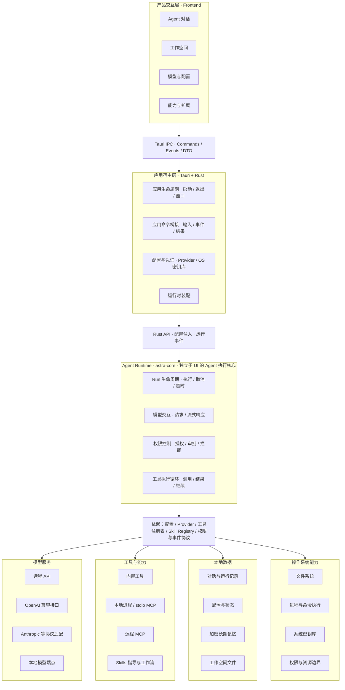

# Astra

Astra 是一个基于 Tauri 2 的**本地优先 AI Agent 桌面应用**。选择一个工作目录，通过对话让 Agent 阅读和修改文件、执行命令、搜索网页、生成文档与图片。数据与密钥全部留在本机。

## 🚀 快速体验

**无需编译，直接下载安装包体验**（macOS / Windows / Linux 三端）：

👉 **[GitHub Releases](https://github.com/astra-praxis/astra/releases)**

选择对应平台安装包下载安装，进入「设置」配置一个 OpenAI 兼容的模型服务即可开始对话。

## 功能特性

- **Agent 对话**：多步骤任务协作，多会话标签页与历史导航
- **文件与工作区**：在指定工作目录中读取、编辑、管理文件
- **工具与扩展**：内置工具（文件、命令、搜索）+ 扩展协议接入外部工具与 Agent + 技能扩展
- **长期记忆**：跨会话自动沉淀，本地加密存储
- **多模型支持**：OpenAI 兼容 API 与本地模型服务
- **Artifact**：集中展示任务生成的文档与结果
- **桌面集成**：Tauri 2 原生桌面体验，多窗口 / 单实例

## 架构总览

Astra · 知行 —— 本地优先的 AI Agent 桌面应用，核心运行时由 Rust 承载，支持远程模型 API 与本地模型服务。

> 注：此图为逻辑架构总览，不代表每个模块均已完整接线；数据存储与记忆的具体调用关系以当前实现为准。

## 核心亮点

### 多会话并行体验

多标签页随时切换，运行中的会话可驻留后台持续工作；会话历史全局平铺、时间分桶，一键恢复。

### 安全优先

Agent 的每次工具调用都经过独立授权，支持多级放权策略；越权操作被硬性拦截。工具输出按不可信数据处理，不因内容获得任何额外权限，高风险操作始终重新经过授权链。记忆数据端到端加密，密钥不离开本机。

### 长期记忆

对话自动沉淀为可复用的长期记忆，跨会话召回；错误记忆可被纠正，旧结论自动失效。

### 三端自动发布

GitHub Actions 一键构建并发布 macOS / Windows / Linux 安装包，版本化 Release 持续更新。

## 技术栈

| 模块 | 技术 |
|---|---|
| 桌面应用 | Tauri 2 |
| 后端 | Rust |
| 前端 | React 19、TypeScript |
| 状态管理 | Zustand |
| UI | Radix UI |
| 构建工具 | Vite、pnpm |
| 扩展协议 | MCP、ACP |
| 本地存储 | SQLite |

## 项目状态

持续开发中，功能和界面随版本调整。欢迎下载体验并反馈问题。

## License

MIT
